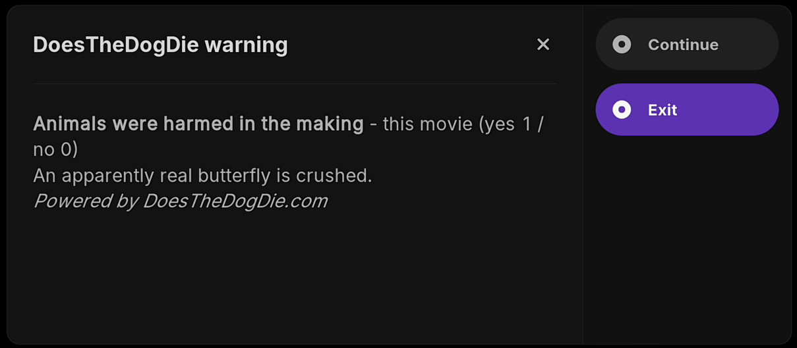

# DoesTheDogDie Warnings for Kodi

A Kodi service add-on (`service.dtdd`). When a video starts, it checks [DoesTheDogDie.com](https://www.doesthedogdie.com). If an animal dies or is hurt in it, the add-on pauses the video and asks you: **Exit** or **Continue**.



## The problem

You press play on a movie and twenty minutes in, the dog dies. DoesTheDogDie.com has the answer for thousands of movies and shows, but only if you remember to look it up before you press play. This add-on looks it up for you, every time, before the scene comes.

## Example

- You start *Marley & Me*. The video pauses and the box shows **A dog dies – this movie (yes 940 / no 44)**, with a short note from a voter.
- **Exit** stops the video. **Continue** plays on from where it paused.
- You start an episode of a show. The box shows only if a voter named **that exact episode** (for example "S2E7"). You never get a vague "something happens somewhere in this show" warning.
- A movie with no animal topics plays with no box at all.

## Why an add-on and not a skin or a plugin

The add-on is a background service. It listens for Kodi's "video started" event, so it works the same way however the video starts:

- your own library (SMB, NFS, local files)
- TMDb Helper
- any other video plugin

No player setup, no skin change.

## How it works

1. A video starts. The add-on reads the IMDb or TMDb id that Kodi has for it. For an episode, it uses the **show's** id plus the season and episode number, because DoesTheDogDie lists shows, not single episodes. Some plugins fill the ids in late, so it waits up to 12 seconds. If there is still no id, it searches by exact title.
2. It looks the title up on DoesTheDogDie and stores the answer in a cache: 7 days for a title, 30 days for an id lookup. A title you play again costs no API request.
3. It decides whether a topic you chose is a hit:
   - **Movie**: more voters say YES than NO.
   - **Episode**: a voter's note names this season and episode, either in the episode fields of the note or in its text ("S2E3", "Season 2 Episode 3", "2x03"). A NO vote that has a note also counts. "The dog is shot but survives" is still worth knowing.
4. On a hit, it pauses the video and shows the box. The box lists the topic, the votes and one short voter note. Notes that look like spam (links, e-mail addresses, phone numbers) are never shown.
5. It never blocks playback. If there is no key, no id, no internet or the API is busy, the video simply plays, and a short note may show in the corner.

## Install

1. Get a free DoesTheDogDie API key:
   1. Open [doesthedogdie.com/api](https://www.doesthedogdie.com/api) and click **Get free key** (in the Free column).
   2. Sign in, or create an account with your e-mail address.
   3. Accept the [API Terms of Service](https://www.doesthedogdie.com/api/terms). The free key is for non-commercial use only.
   4. You land on your **Profile** page. Copy the API key shown there (it starts with `ddd_`).

   You can find the key again at any time on [doesthedogdie.com/profile](https://www.doesthedogdie.com/profile).
2. Download `service.dtdd-<version>.zip` from the [latest release](https://github.com/Megarushing/kodi-dtdd/releases/latest).
3. In Kodi, open **Settings → Add-ons → Install from zip file** and pick the zip you downloaded. Kodi asks you to allow "Unknown sources" the first time.
4. Open the add-on's settings (**Add-ons → My add-ons → Services → DoesTheDogDie Warnings → Configure**) and paste your API key.

The add-on needs Kodi 19 (Matrix) or newer.

## Settings

| Setting | What it does |
|---|---|
| **API key** | Your DoesTheDogDie key. Without it, the add-on does nothing, and you get one short note per Kodi start. |
| **Choose topics** | Opens a list of all DoesTheDogDie topics (about 290). Tick the ones that should pause the video. |
| **Note when site is unreachable** | On by default. A rejected API key is always shown. |

Topics on by default (animal deaths and harm):

- a dog dies, a cat dies, a horse dies, a pet dies, an animal dies
- animals are abused, an animal is hit by a vehicle, there's animal fighting, rabbits are harmed, animals were harmed in the making

Off by default: a dragon dies, an animal is abandoned, an animal is sad, an animal attacks someone, bugs, and every topic about people. You can tick any of them, or any human topic, in **Choose topics**.

## Limits

- **The warnings come from voters.** A title with few votes can be missing a topic or be wrong. The add-on shows the vote counts so you can judge.
- **Episodes need a voter who named the episode.** Many shows have notes only at show level. Those never trigger a box, by design.
- **API limits** (free key): 30 requests per minute and 5,000 per month, non-commercial use. A new title costs 2 to 5 requests. The cache keeps normal use far below the limit.
- **Kodi's box has no scroll bar.** If you tick many topics and several hit, the text scrolls by itself after a few seconds.
- The box text is in English only.

## Develop

- Tests use only the Python standard library:
  ```sh
  python3 -m unittest discover -s tests -v
  ```
  The fixtures in `tests/fixtures/` are trimmed real API answers for *Marley & Me* and *Body Cam*.
- The code lives in `service.dtdd/dtdd_lib/`. `logic.py` has no Kodi imports and holds all the decisions. `api.py` is the API client and cache. `service.py` is the Kodi side.
- The package is called `dtdd_lib` and not `resources.lib`, because other add-ons ship a `resources.lib` package too, and Python can load theirs instead.

## Credits

Powered by [DoesTheDogDie.com](https://www.doesthedogdie.com). This add-on is not affiliated with DoesTheDogDie.com.

## License

MIT, see [LICENSE](LICENSE).
